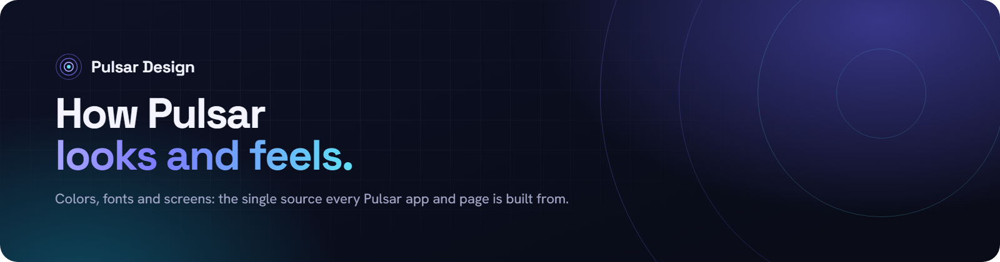
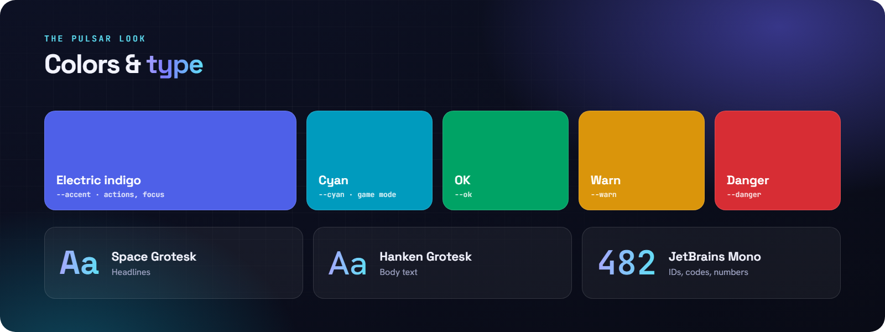

<p align="center">
  <a href="https://pulsardesk.com"></a>
</p>

<h3 align="center">How Pulsar looks and feels.</h3>

<p align="center">
  Colors, fonts, components and screen designs for every Pulsar app and the website.<br>
  One source, so the desktop app, the phone app and <a href="https://pulsardesk.com">pulsardesk.com</a> always look like one product.
</p>

<p align="center">
  <a href="https://github.com/PulsarDesk/design/actions/workflows/ci.yml"></a>
  <a href="https://github.com/PulsarDesk/design/stargazers"></a>
  <a href="LICENSE"></a>
</p>

> [!TIP]
> **Looking for the app?** Get **[Pulsar Desktop](https://github.com/PulsarDesk/pulsar-desktop)** (Windows, macOS,
> Linux) or **[Pulsar Mobile](https://github.com/PulsarDesk/pulsar-mobile)** (Android).

## 🎨 The Pulsar look

<p align="center"></p>

<table>
<tr>
<td width="25%" valign="top">

### ☀️ Light first
Calm, bright surfaces by default. The desktop app adds a dark theme on top.

</td>
<td width="25%" valign="top">

### 💜 Electric indigo
The one accent color: buttons, focus, what matters on screen.

</td>
<td width="25%" valign="top">

### 🎮 Cyan for games
Game mode switches the accent to cyan, so you always know where you are.

</td>
<td width="25%" valign="top">

### ◎ Pulse rings
The logo: concentric rings, like a signal going out from one point.

</td>
</tr>
</table>

## 📦 What's here

| | Where | What |
|---|---|---|
| 🎯 | [`project/assets/tokens.css`](project/assets/tokens.css) | **The source of truth**: colors, fonts, spacing, radii, shadows, motion |
| 🖼️ | [`project/`](project/) | Screen designs as HTML prototypes: the app, the website, the download page (open them in a browser) |
| ⚛️ | [`ds-react/`](ds-react/) | The same components as a React package: buttons, cards, toggles, the ID display, the app shell |
| 🌠 | [`readme-assets/`](readme-assets/) | The banners and illustrations at the top of every Pulsar README |

The apps and the website copy their values from `tokens.css`, so **a change starts here** and is then carried over.

## 🐞 Reporting a bug

Something looks wrong in an app? Report it in the app's repository
([desktop](https://github.com/PulsarDesk/pulsar-desktop/issues/new/choose) or
[mobile](https://github.com/PulsarDesk/pulsar-mobile/issues/new/choose)) with a screenshot. Open an issue
[here](https://github.com/PulsarDesk/design/issues/new/choose) for problems in the design files themselves.

## 🛠️ For developers

<details>
<summary>Build the React package</summary>

**Needs:** [bun](https://bun.sh).

```bash
git clone https://github.com/PulsarDesk/design.git
cd design/ds-react
bun install
bun run build
```

The designs came from a Claude Design handoff; notes for coding agents are in [HANDOFF.md](HANDOFF.md).

</details>

Everyone is welcome to open [issues](https://github.com/PulsarDesk/design/issues) and pull requests. Irrelevant or
abusive issues may be closed or removed. Commits follow [Conventional Commits](https://www.conventionalcommits.org).

## 🌌 The Pulsar family

| | Project | |
|---|---|---|
| 🖥️ | [**Pulsar Desktop**](https://github.com/PulsarDesk/pulsar-desktop) | Pulsar for Windows, macOS and Linux |
| 📱 | [**Pulsar Mobile**](https://github.com/PulsarDesk/pulsar-mobile) | Pulsar for Android phones, tablets and TVs |
| 🌐 | [**Website**](https://github.com/PulsarDesk/web) | [pulsardesk.com](https://pulsardesk.com) |

## 📄 License

Pulsar is free software under the **GNU GPLv3 or later** (GPL-3.0-or-later). See [LICENSE](LICENSE).

<p align="center">
  <br>
  <b>Like Pulsar? A ⭐ helps other people find it.</b>
</p>
